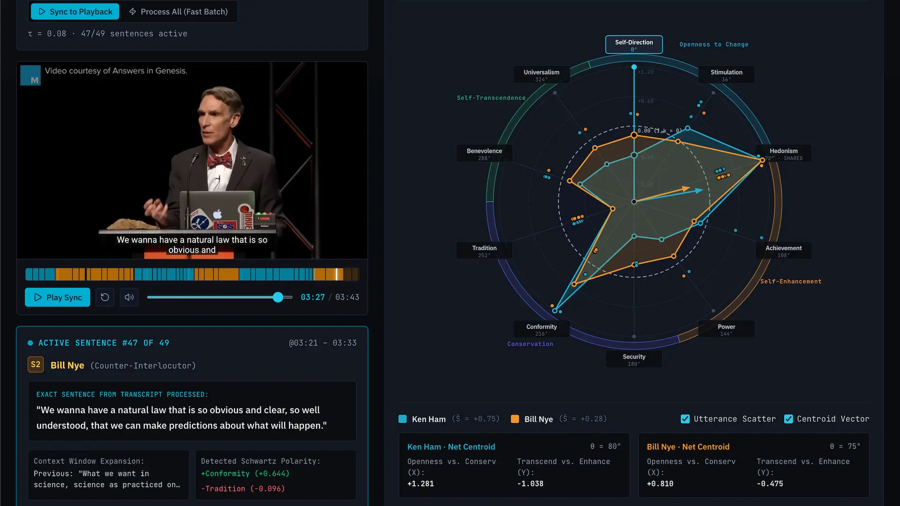

# Valuelizer

<div align="center">
  
  <p><em>Real-Time Psychometric Values Profiling of YouTube Conversations & Debates</em></p>
</div>

---

## Overview

**Valuelizer** analyzes YouTube discussions and debates in real time by projecting speech turns onto **Shalom H. Schwartz’s Theory of Basic Human Values**. Using dual-anchor vector polarities, it quantifies each speaker's psychological motivations across 10 universal value axes and four higher-order motivational domains.

### Key Capabilities
- **Live Circumplex Radar**: Visualizes evolving speaker value profiles across *Openness to Change*, *Self-Enhancement*, *Conservation*, and *Self-Transcendence*.
- **Sub-Second Transcript Mapping**: Automatically extracts native YouTube caption streams with exact millisecond timestamps and zero hallucination.
- **Dynamic Speaker Diarization**: Clusters utterances and attributes speaking turns using `gemini-3.5-flash-lite`.
- **Dual-Anchor Psychometric Engine**: Compares utterance embeddings against positive ($c_k^+$) and negative ($c_k^-$) Portrait Values Questionnaire (PVQ) reference anchors.
- **Value Friction & Synergy**: Computes real-time alignment and tension metrics between opposing interlocutors.
- **Offline / Quota Resilience**: Intelligent tier fallback supporting `gemini-embedding-2-preview`, server-side batch caching, and local in-browser transformers (`all-MiniLM-L6-v2`).

---

## Quickstart

### Prerequisites
- **Node.js**: v18.0.0 or higher
- **Gemini API Key**: Obtainable from [Google AI Studio](https://aistudio.google.com/)

### Setup & Run

1. **Clone and install dependencies**:
   ```bash
   cd Valuelizer
   npm install
   ```

2. **Configure environment variables**:
   ```bash
   cp .env.example .env
   ```
   Add your API key to `.env`:
   ```env
   GEMINI_API_KEY="your-gemini-api-key"
   ```

3. **Start the development server**:
   ```bash
   npm run dev
   ```
   Open [http://localhost:3000](http://localhost:3000) in your browser.

4. **Production Build**:
   ```bash
   npm run build
   npm run preview
   ```

---

## Technical Specifications

| Layer | Technology | Details |
|---|---|---|
| **Frontend** | React 19 · TypeScript · Vite 8 | Pure client-side SPA with Tailwind CSS v4 and Motion animations |
| **Circumplex Visualization** | HTML5 Canvas 2D | Custom circular ipsative circumplex radar renderer with dynamic smoothing |
| **Server & Middleware** | Express.js · Node.js ESM | Embedded Vite dev server, caption parser, and Gemini API proxy |
| **LLM & Diarization** | Google Gemini SDK (`@google/genai`) | `gemini-3.5-flash-lite` for conversational diarization and polarity audit |
| **Embedding Models** | Multimodal & Dense Vectors | `gemini-embedding-2-preview` / `gemini-embedding-001` with local `@xenova/transformers` fallback |
| **Audio/Video Ingestion** | YouTube InnerTube Client | Native Android player endpoint for raw XML timed-text captions (zero CLI dependencies) |
| **Player Sync** | YouTube IFrame Player API | Continuous sub-second polling (`timeupdate`), timeline seeking, and bi-directional scrub sync |

---

## Pre-Indexed Benchmark Debates

Valuelizer includes three pre-indexed debates with authentic transcripts, verified speakers, and sub-second timeline alignment:

1. **StarTalk: Astrophysicists Debate Free Will** — [https://www.youtube.com/watch?v=LXvv6CbGg8A](https://www.youtube.com/watch?v=LXvv6CbGg8A)
   *Neil deGrasse Tyson* vs. *Charles Liu* — Determinism, agency, and cosmic causality (52 turns, 0s–560s).
2. **Wealth, Poverty, and Politics** — [https://www.youtube.com/watch?v=sGYl17DiEwo](https://www.youtube.com/watch?v=sGYl17DiEwo)
   *Peter Robinson* vs. *Dr. Thomas Sowell* — Productivity vs. wealth redistribution (11 turns, 0.7s–278.4s).
3. **Sam Altman & Lex Fridman Podcast #419** — [https://www.youtube.com/watch?v=jvqFAi7vkBc](https://www.youtube.com/watch?v=jvqFAi7vkBc)
   *Lex Fridman* vs. *Sam Altman* — AGI scaling, compute currency, and governance (33 turns, 0s–278.5s).

Custom YouTube URLs can also be loaded directly via the search bar for on-the-fly caption parsing and psychometric mapping.